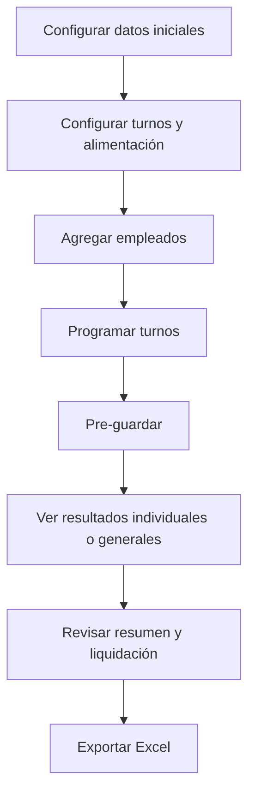

# Sistema de Control de Turnos y Horas Extras

Documentación oficial para operación funcional, mantenimiento técnico y despliegue web.

| Campo | Valor |
|---|---|
| **Versión del sistema** | 5.0 |
| **Versión del documento** | 3.0 |
| **Fecha** | Noviembre 2026 |
| **Autor** | Alejostone |
| **Empresa / titular** | Alejostone |
| **Repositorio** | `Alejostone1/Turnos_Claret` |

---

## 1. Descripción General

El sistema permite programar turnos por empleado y calcular automáticamente recargos, horas extras y liquidación de adicionales para nómina.

### ¿Qué resuelve?

- Errores manuales en clasificación de horas.
- Dificultad para liquidar semanas con festivos, domingos y cruces de medianoche.
- Falta de trazabilidad en cálculo de recargos y exportables.

### Público objetivo

- RR. HH.
- Nómina.
- Coordinadores operativos.
- Soporte técnico.

---

## 2. Características Principales

- Programación de turnos por día y por empleado con selector visual de tarjetas (turnos y conceptos de nómina separados).
- Turnos dinámicos: crear, editar, desactivar y **eliminar** (con limpieza real de referencias).
- Turno manual por día específico.
- Configuración de alimentación (sin, predefinida, personalizada).
- Motor de cálculo minuto a minuto con clasificación **cronológica** al cruzar el tope.
- Tope semanal de 42 h; incapacidad y vacaciones suman 7,33 h según reglas (ver 10.2).
- Colores fijos para Incapacidad, Sin contrato, Permiso, Ausencia y Vacaciones.
- Pre-guardado persistente: la programación se recupera al recargar la página.
- Resultados **individuales** por empleado y resultados generales.
- Configuración del sistema protegida con contraseña.
- Liquidación por concepto.
- Exportación a Excel (general o individual) con hoja de novedades de nómina.

---

## 3. Módulos del Sistema

| Módulo | Función |
|---|---|
| **Configuración inicial** | Define período, empleados y salario base. |
| **Configuración de turnos** | Administra turnos base y dinámicos. |
| **Configuración de alimentación** | Define descuento no laborado. |
| **Programación** | Asignación diaria en calendario semanal. |
| **Empleados** | Alta (documento solo numérico), edición, eliminación y pre-guardado persistente. |
| **Resultados** | Individuales por empleado o generales; detalle por día y tipo de hora. |
| **Resumen del período** | Consolidado por empleado. |
| **Liquidación** | Cálculo monetario de recargos/extras. |
| **Exportación** | Generación de archivo Excel multihoja. |
| **Configuración del sistema** | Recargos, horario nocturno y conceptos de nómina (protegida con contraseña). |

---

## 4. Arquitectura y Compatibilidad

## 4.1 Componentes del proyecto

| Componente | Ruta | Web (Vercel) | Escritorio (Electron) |
|---|---|---|---|
| Entrada principal web | `index.html` | ✅ | ✅ |
| Vista principal | `INICIO_TURNOS.html` | ✅ | ✅ |
| Motor de UI y cálculo | `archivos/TURNOS.js` | ✅ | ✅ |
| Estilos | `archivos/TURNOS.css` | ✅ | ✅ |
| Manual embebido | `archivos/instructivo.js` | ✅ | ✅ |
| Manual fuente | `archivos/instructivo.md` | ✅ | ✅ |
| Proceso principal Electron | `archivos/main.js` | ❌ | ✅ |
| Preload Electron | `archivos/preload.js` | ❌ | ✅ |
| Config NPM Electron | `archivos/package.json` | ❌ | ✅ |
| Pruebas automáticas | `test/*.js` | Node.js | Node.js |

## 4.2 Funciones incompatibles con Vercel (y alternativa)

| Función | Motivo | Alternativa Web |
|---|---|---|
| `ipcMain`, `BrowserWindow`, `dialog`, `fs` | APIs nativas de Electron/Node en desktop | No se usan en web |
| `window.electronAPI.saveFile(...)` | Bridge preload exclusivo de Electron | `XLSX.writeFile(...)` en navegador |

El sistema ya tiene fallback: si `window.electronAPI` no existe, exporta el Excel directamente en navegador.

---

## 5. Requisitos

### Funcionales

- Datos mínimos del empleado (documento, nombre, salario).
- Turnos configurados.

### Técnicos

- Navegador moderno (Chrome, Edge, Firefox).
- Resolución sugerida: 1366×768 o superior.
- Para desktop: Node.js + Electron (dependencias en `archivos/package.json`).

---

## 6. Estructura del Proyecto

```text
.
├── index.html
├── INICIO_TURNOS.html
├── vercel.json
├── README.md
├── .gitignore
├── archivos/
│   ├── TURNOS.js
│   ├── TURNOS.css
│   ├── instructivo.js
│   ├── instructivo.md
│   ├── main.js
│   ├── preload.js
│   ├── package.json
│   └── ...
└── test/
    ├── entorno_prueba.js
    ├── test_motor.js
    ├── test_conceptos.js
    ├── test_runner.html
    ├── turnos_scenarios.js
    └── turnos_scenarios.json
```

---

## 7. Instalación y Ejecución Local

## 7.1 Versión Web (sin Electron)

1. Clonar repositorio.
2. Abrir `INICIO_TURNOS.html` (o `index.html`) en navegador.
3. Usar la aplicación.

## 7.2 Versión Escritorio (Electron)

1. Ir a `archivos/`.
2. Instalar dependencias:
   ```bash
   npm install
   ```
3. Ejecutar:
   ```bash
   npm start
   ```

---

## 8. Flujo de Uso



---

## 9. Configuración Funcional

### 9.1 Recargos y extras (por defecto)

| Concepto | Valor |
|---|---:|
| Recargo nocturno | 35% |
| Recargo festivo diurno | 90% |
| Recargo festivo nocturno | 125% |
| Hora extra diurna | 25% |
| Hora extra nocturna | 75% |
| Hora extra festiva diurna | 115% |
| Hora extra festiva nocturna | 165% |

### 9.2 Horario nocturno

- Inicio: `19:00`
- Fin: `06:00`

### 9.3 Alimentación

- Sin almuerzo.
- Predefinido (30 min / 1 hora).
- Personalizado.
- Regla especial 24H: segunda pausa (si aplica en operación).

---

## 10. Motor de Cálculo (Resumen)

- Cómputo por semana completa (domingo-sábado).
- Clasificación minuto a minuto para precisión real.
- Distribución ordinarias/extras según tope semanal.
- Conversión monetaria por tipo de hora.

Fórmula base:

```text
Valor hora ordinaria = salario mensual / 220
```

### 10.1 Tope semanal y horas extras

- El tope base es **42 horas por semana** (domingo a sábado). El acumulado se reinicia cada domingo.
- Los días se recorren en orden llevando un **acumulado semanal**. Suman: horas realmente trabajadas (turnos dinámicos y manual) y las horas reconocidas de incapacidad/vacaciones (10.2).
- Cada minuto trabajado se clasifica **cronológicamente**: lo anterior al instante en que se alcanza el tope es ordinario; lo posterior es extra, con la naturaleza (diurna/nocturna, hábil/festiva) del momento en que ocurre.
- Los festivos no trabajados **no reducen** el tope.
- Domingo trabajado sin ningún día libre (`C`) en la semana: sus horas se liquidan como extras.

### 10.2 Conceptos especiales

Los conceptos especiales **no son horas trabajadas**: nunca generan horas ordinarias, extras ni recargos por sí mismos.

| Concepto | Código | Horas por defecto | Efecto en el tope de 42 h |
|---|---|---:|---|
| Incapacidad | `I` | 7,33 | **Suma** al acumulado, excepto domingo y festivo, y solo si la semana tiene al menos un turno trabajado |
| Vacaciones | `V` | 7,33 | Igual que incapacidad |
| Permiso remunerado | `PR` | 7 | No suma; solo cubre la deuda semanal |
| Ausencia | `A` | 7 | Resta sus horas del acumulado |
| Sin contrato | `SC` | 7 | Reduce el tope en sus horas (lunes a sábado) |
| Libre | `C` | 0 | Sin efecto |

**Ejemplos** (tope 42 h):

| Semana | Trabajadas | I/V que suman | Extras |
|---|---:|---:|---:|
| Dom `I`, Lun `I`, Mar–Jue turnos de 11 h | 33 h | 7,33 h (el domingo no suma) | 0 h (40,33 < 42) |
| Dom `V`, Lun–Mié `V`, Jue–Sáb turnos de 11 h | 33 h | 21,99 h | 12,99 h (desde el viernes) |
| Lun–Sáb `I`, sin turnos | 0 h | 0 h (sin turno trabajado) | 0 h |
| Lun `PR`, Mar–Vie turnos de 11 h | 44 h | 0 h | 2 h |

**Deuda semanal:**

```text
Deuda = máx(0, Tope − (Horas trabajadas + Horas I/PR/V − Horas A))
```

Las horas de I/PR/V cubren la deuda excepto en domingo y festivo. Un concepto personalizado cuyo nombre contenga *incapacidad* o *vacaciones* se trata como `I`/`V`; con *permiso remunerado*, como `PR`.

### 10.3 Exportación a Excel

| Hoja | Contenido |
|---|---|
| Informe Horas Extras | Formato de importación a nómina (códigos 045, 046, 011, …). Una fila por día trabajado o con concepto |
| Novedades de Nómina | Fechas de incapacidad, vacaciones, permisos, ausencias y sin contrato, con su efecto en el tope |
| Liquidación de Pago | Valores por concepto y total por empleado (números con formato moneda) |
| Resumen Total Horas | Totales del período, incluidas horas reconocidas por I/V |
| Semana N | Detalle diario, tipo de día y si el día está dentro del período |
| Resumen de Turnos | Conteo por tipo de turno y semana |

Todo sale de la misma fuente que la pantalla (`calcularResumenPeriodo`, `calcularLiquidacionEmpleado`). En resultado individual se exporta solo ese empleado.

### 10.4 Pruebas automáticas

No requieren navegador:

```bash
node test/test_motor.js
node test/test_conceptos.js
```

`test_motor.js` cubre: tope de 42 h, incapacidad/vacaciones (domingo, festivo, semana sin trabajo), clasificación nocturna/festiva, cruces de medianoche, turno de 24 h, alimentación (30 min, 1 h, personalizada), cruce cronológico del tope, eliminación de turnos, pre-guardado y recuperación, resultados individuales, coincidencia Excel = pantalla, validación de documento, contraseña y colores fijos.

Ejecute ambas después de cualquier cambio en `archivos/TURNOS.js`.

---

## 11. Preparación para Vercel (ya implementada)

Este repositorio quedó listo para deploy estático en Vercel con:

- `index.html` como entrada del dominio.
- `INICIO_TURNOS.html` como vista principal.
- `vercel.json` con routing y headers.
- Rutas relativas compatibles web (`archivos/...`).
- SEO básico en `INICIO_TURNOS.html` (`title`, `description`, OG, favicon, viewport, charset).
- Separación clara entre capa web y capa Electron.

---

## 12. Despliegue en Vercel (CI/CD con GitHub)

1. Subir cambios a GitHub (`main` o rama de release).
2. Entrar a Vercel y conectar el repositorio.
3. En **Project Settings**:
   - Framework: `Other`
   - Build Command: *(vacío)*
   - Output Directory: *(vacío / raíz)*
4. Deploy.

La URL quedará disponible como:

`https://<nombre-proyecto>.vercel.app`

No requiere configuración adicional porque `vercel.json` ya está incluido.

---

## 13. Actualización del Proyecto

1. Realizar cambios en repo.
2. Push a GitHub.
3. Vercel ejecuta redeploy automático.
4. Validar URL publicada.

---

## 14. Solución de Problemas

### La app abre pero sin estilos

- Verifique que `archivos/TURNOS.css` exista y sea accesible.

### Cambié el código pero el navegador sigue calculando igual

- `INICIO_TURNOS.html` carga `TURNOS.js` y `TURNOS.css` con un parámetro de versión (`?v=AAAAMMDDhhmm`). Actualícelo en cada cambio para forzar la recarga.
- Como alternativa, recargue con **Ctrl + F5**.

### El manual no aparece

- Verifique `archivos/instructivo.js`.
- `archivos/instructivo.md` se usa como fallback.

### El Excel no descarga en web

- Permita descargas del navegador.
- Verifique bloqueo por extensiones o políticas corporativas.

### En desktop no abre Electron

- Ejecute `npm install` dentro de `archivos/`.
- Revise versión de Node y permisos.

---

## 15. Seguridad y Consideraciones

- No se publican secretos en esta estructura.
- Persistencia en navegador vía `localStorage`.
- La contraseña de Configuración (`Alejostone`) se valida en el navegador y puede verse en el código fuente: evita cambios accidentales, **no es seguridad real**. Para protección real se requiere un backend con autenticación.
- La programación pre-guardada vive en el `localStorage` de cada navegador y equipo; no se sincroniza entre equipos.
- Recursos externos CDN con versión fija: `marked@12.0.2` y `xlsx-js-style@1.2.0` (dependen de disponibilidad del CDN).

> Recomendación técnica: para máxima resiliencia offline en web, migrar esas librerías a archivos locales versionados en `archivos/`.

---

## 16. Buenas Prácticas

1. Configurar turnos y alimentación antes de programar.
2. Pre-guardar cada empleado al terminar su programación.
3. Validar festivos/domingos antes de liquidar.
4. Estandarizar códigos de turno/concepto.
5. Exportar y respaldar Excel al cerrar cálculo.
6. Registrar incapacidades, permisos y vacaciones con su concepto (`I`, `PR`, `V`) y no como turno trabajado, para que no generen extras.

---

## 17. Créditos

- **Autor:** Alejostone
- **Sistema:** Sistema de Control de Turnos y Horas Extras
- **Versión:** 5.0
- **Repositorio:** `Alejostone1/Turnos_Claret`

---

## 18. Informe de auditoría

El detalle de errores encontrados, cambios y pruebas de la versión 5.0 está en [INFORME_AUDITORIA.md](INFORME_AUDITORIA.md).
