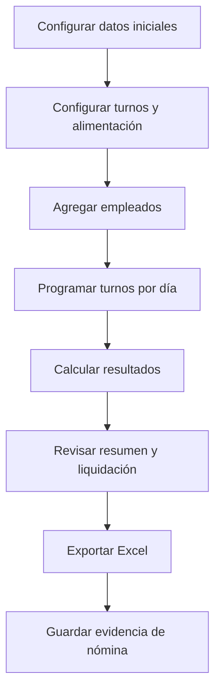

# Sistema de Control de Turnos y Horas Extras

> Documentación oficial del proyecto

| Campo | Información |
|---|---|
| **Sistema** | Sistema de Control de Turnos y Horas Extras |
| **Versión funcional** | 4.8 |
| **Versión del documento** | 1.0 (README oficial) |
| **Fecha** | Julio 2026 |
| **Autor** | Alejostone |
| **Empresa / Titular** | Alejostone |
| **Repositorio** | `Alejostone1/Turnos_Claret` |

Aplicación para programación de turnos, cálculo de recargos/horas extras y generación de liquidación/exportables para nómina.

---

## 1. Descripción General

El sistema permite planificar turnos de trabajo de múltiples empleados y calcular automáticamente:

- Horas ordinarias.
- Horas nocturnas.
- Horas festivas.
- Horas nocturnas festivas.
- Horas extras (diurnas/nocturnas/festivas/nocturnas festivas).

Además, integra configuración de recargos, conceptos de nómina (ausencias/licencias), alimentación y exportación a Excel.

### Propósito

Resolver errores y reprocesos en liquidaciones manuales, especialmente en escenarios complejos:

- Turnos que cruzan medianoche.
- Domingos y festivos.
- Turnos de 24 horas.
- Varios empleados y semanas en un mismo período.

### Público objetivo

- Analistas de nómina.
- Coordinadores de operación/turnos.
- Áreas de RR. HH.
- Soporte técnico interno.

---

## 2. Características Principales

- Configuración inicial de período, salario y cantidad de empleados.
- Turnos dinámicos (crear, editar, activar/desactivar, eliminar).
- Turno manual por día.
- Configuración de alimentación (sin almuerzo, predefinido, personalizado).
- Motor de cálculo minuto a minuto para clasificación precisa.
- Cálculo de horas extras con tope semanal.
- Reglas de domingos/festivos.
- Conceptos de nómina con horas equivalentes configurables.
- Panel de configuración de recargos y códigos de exportación.
- Vista de resultados semanales y resumen total.
- Liquidación de pago por concepto.
- Exportación a Excel (múltiples hojas).

---

## 3. Módulos del Sistema

| Módulo | Función |
|---|---|
| **Configuración Inicial** | Define período, salario base y parámetros generales antes de programar. |
| **Configuración de Turnos** | Administra turnos base y dinámicos (horario, color, código, estado). |
| **Configuración de Alimentación** | Define descuento de alimentación aplicable a los turnos. |
| **Programación de Turnos** | Asignación diaria por empleado en calendario semanal (dom-sáb). |
| **Gestión de Empleados** | Alta, edición y eliminación de empleados; pre-guardado de turnos. |
| **Resultados Semanales** | Desglose por día/semana de horas clasificadas y totales. |
| **Resumen Total** | Consolidado del período por empleado. |
| **Liquidación de Pago** | Conversión de horas a valores monetarios por recargo/extra. |
| **Exportación** | Generación de archivo Excel con informes y detalles por semana. |
| **Panel de Configuración del Sistema** | Ajuste de porcentajes, horario nocturno, recargos, extras y conceptos. |

---

## 4. Requisitos

### 4.1 Funcionales

- Datos de empleados (documento, nombre, salario, período).
- Configuración de turnos operativos.

### 4.2 Técnicos

- **Sistema operativo recomendado:** Windows.
- **Modo de ejecución:** Electron (aplicación de escritorio) o navegador.
- **Resolución recomendada:** 1366×768 o superior.
- **Navegador recomendado (si aplica):** Google Chrome/Edge actualizados.
- **Persistencia local:** `localStorage`.

> **Nota (recomendación):** para entornos productivos, usar siempre el ejecutable/entorno Electron para evitar restricciones de `file://` del navegador.

---

## 5. Instalación y Puesta en Marcha

### 5.1 Ejecución directa (operativa)

1. Descargue o clone el repositorio.
2. Verifique la estructura mínima:
   - `INICIO_TURNOS.html`
   - `archivos/`
   - `test/`
3. Abra `INICIO_TURNOS.html`.

### 5.2 Ejecución con Electron (técnica)

1. Abra terminal en `archivos/`.
2. Instale dependencias:
   ```bash
   npm install
   ```
3. Ejecute:
   ```bash
   npm start
   ```

---

## 6. Flujo de Uso Recomendado



Pasos prácticos:

1. Definir período y salario base.
2. Ajustar turnos dinámicos.
3. Confirmar política de alimentación.
4. Registrar empleados.
5. Programar semana por semana.
6. Ejecutar cálculo.
7. Validar resultados.
8. Exportar Excel.

---

## 7. Configuraciones Disponibles

### 7.1 Turnos

- Horario inicio/fin.
- Nombre visible.
- Código.
- Color.
- Activación/desactivación.

### 7.2 Alimentación

- Sin descuento.
- Predefinido (30 min / 1 h).
- Personalizado (inicio-fin).
- Regla especial en 24H (segunda pausa).

### 7.3 Recargos y extras

Valores por defecto:

| Concepto | % por defecto |
|---|---:|
| Recargo nocturno | 35% |
| Recargo festivo diurno | 90% |
| Recargo festivo nocturno | 125% |
| Hora extra diurna | 25% |
| Hora extra nocturna | 75% |
| Hora extra festiva diurna | 115% |
| Hora extra festiva nocturna | 165% |

### 7.4 Horario nocturno

- Inicio por defecto: `19:00`
- Fin por defecto: `06:00`

### 7.5 Conceptos de nómina

- Predefinidos: `I`, `SC`, `PR`, `A`, `V`, `C`.
- Alta/edición/eliminación de conceptos personalizados.

---

## 8. Motor de Cálculo (Resumen Técnico-Funcional)

### 8.1 Principios

- Cálculo por semana completa (domingo a sábado).
- Clasificación minuto a minuto.
- Separación por tipo de hora y por condición festiva/nocturna.
- Distribución entre horas ordinarias y extras según tope semanal.

### 8.2 Alimentación

El descuento de alimentación se integra al cálculo de horas efectivas del turno según la configuración activa.

### 8.3 Clasificación de horas

Se clasifica en:

- Ordinaria diurna.
- Ordinaria nocturna.
- Ordinaria festiva.
- Ordinaria nocturna festiva.
- Extra diurna.
- Extra nocturna.
- Extra festiva.
- Extra nocturna festiva.

### 8.4 Valor hora y liquidación

```text
Valor hora ordinaria = Salario mensual / 220
```

- **Recargo:** `valorHora × (porcentaje/100)`
- **Hora extra:** `valorHora × (1 + porcentaje/100)`

---

## 9. Buenas Prácticas de Operación

1. Configure turnos y alimentación antes de programar masivamente.
2. Use **Pre-guardar turnos** antes de editar períodos de empleados.
3. Revise días festivos/domingos resaltados antes de calcular.
4. Estandarice códigos cortos de turnos y conceptos.
5. Exporte inmediatamente después de validar resultados.

---

## 10. Solución de Problemas (FAQ)

### No abre el sistema
- Verifique que exista `INICIO_TURNOS.html` en raíz.
- Verifique que la carpeta `archivos/` contenga `TURNOS.js` y `TURNOS.css`.

### El manual no carga
- Verifique `archivos/instructivo.js` y `archivos/instructivo.md`.
- En navegador local, algunas políticas de `file://` pueden limitar lecturas directas.

### No aparece un turno en el selector
- Revise si está desactivado en Configuración de Turnos.
- Verifique que el código no esté duplicado o inválido.

### El Excel no exporta
- Valide permisos de escritura en carpeta destino.
- Si usa Electron, confirme que se abre el diálogo de guardado.

### Cambié configuración y no se refleja
- Guarde cambios en el panel de configuración.
- Recalcule resultados tras cambios estructurales.

---

## 11. Novedades de la Versión

### 11.1 Funcionales destacadas

- Turnos dinámicos y personalizables.
- Cálculo robusto de cruces de medianoche.
- Multiempleado en un solo período.
- Consolidación y exportación ampliadas.

### 11.2 Cambios técnicos relevantes

- Motor de clasificación minuto a minuto.
- Mejoras en consistencia de cálculo de turnos/alimentación.
- Estructura reorganizada del proyecto:
  - `INICIO_TURNOS.html` (raíz)
  - `archivos/` (motor, estilos, electron, documentación interna)
  - `test/` (escenarios y runner)

---

## 12. Estructura del Repositorio

```text
.
├── INICIO_TURNOS.html
├── archivos/
│   ├── TURNOS.js
│   ├── TURNOS.css
│   ├── main.js
│   ├── preload.js
│   ├── instructivo.js
│   ├── instructivo.md
│   └── ...
└── test/
    ├── test_runner.html
    ├── turnos_scenarios.js
    └── turnos_scenarios.json
```

---

## 13. Créditos

- **Autor:** Alejostone  
- **Proyecto:** Sistema de Control de Turnos y Horas Extras  
- **Versión:** 4.8  
- **Repositorio:** `Alejostone1/Turnos_Claret`

---

### Nota de alcance documental

Este README fue elaborado a partir del instructivo funcional del proyecto y reorganizado con enfoque de documentación oficial. Donde no había detalle explícito, se incluyeron recomendaciones de operación y soporte siguiendo buenas prácticas de software.
